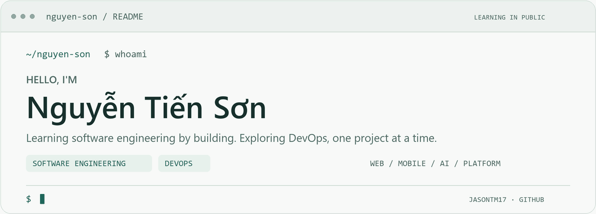
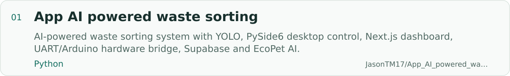
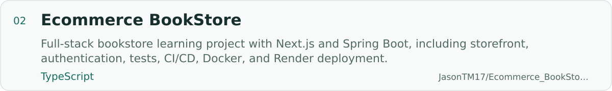
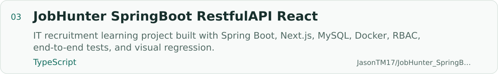
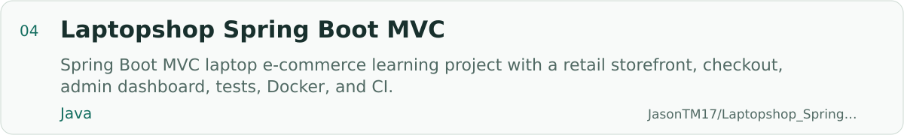
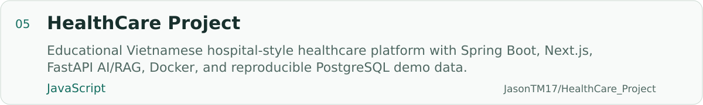
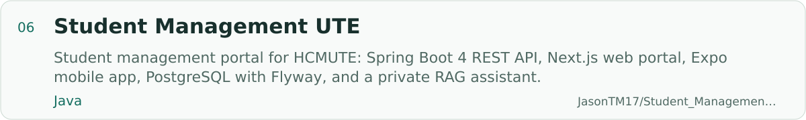

<code>SOFTWARE ENGINEERING · DEVOPS · SYSTEMS</code>

<h1 align="center">Hi, I'm Nguyễn Tiến Sơn 👋</h1>

  <strong>Learning Software Engineering by building. Learning DevOps by shipping thoughtfully.</strong>

  I connect web, mobile, AI, Java, and platform ideas through hands-on projects.

  <em>I'm still learning, and thoughtful feedback, suggestions, and constructive guidance are always welcome.</em>

<!-- AUTO:PROJECT_BADGES:START -->

  
  

<!-- AUTO:PROJECT_BADGES:END -->

  <picture>
    <source media="(max-width: 600px) and (prefers-color-scheme: dark) and (prefers-reduced-motion: reduce)" srcset="./assets/nguyen-son-terminal-dark-mobile.svg" />
    <source media="(max-width: 600px) and (prefers-reduced-motion: reduce)" srcset="./assets/nguyen-son-terminal-light-mobile.svg" />
    <source media="(prefers-color-scheme: dark) and (prefers-reduced-motion: reduce)" srcset="./assets/nguyen-son-terminal-dark.svg" />
    <source media="(prefers-reduced-motion: reduce)" srcset="./assets/nguyen-son-terminal-light.svg" />
    <source media="(max-width: 600px) and (prefers-color-scheme: dark)" srcset="./assets/nguyen-son-terminal-dark-mobile.gif" />
    <source media="(max-width: 600px)" srcset="./assets/nguyen-son-terminal-light-mobile.gif" />
    <source media="(prefers-color-scheme: dark)" srcset="./assets/nguyen-son-terminal-dark.gif" />
    
  </picture>

<!-- PIXEL_COMPANIONS:START -->

  <picture>
    <source media="(prefers-reduced-motion: reduce)" srcset="./assets/pixel-companions/coding-duo.png" />
    
  </picture>

<!-- PIXEL_COMPANIONS:END -->

<!-- AUTO:PROJECT_STATS:START -->

  <strong>52</strong> public projects &nbsp;&middot;&nbsp;
  <strong>6</strong> pinned projects &nbsp;&middot;&nbsp;
  <strong>1</strong> interactive 3D portfolio

<!-- AUTO:PROJECT_STATS:END -->

## Engineering Focus

My projects connect application development, applied AI, and cloud delivery, with a focus on how each part works within the wider system.

- **Product Engineering** — Web and mobile applications, backend services, and APIs designed around practical user workflows.
- **Real-Time Systems** — Delivery, messaging, and location-aware features, with attention to state consistency and timely updates.
- **Applied AI** — Trip planning, computer vision, and retrieval-assisted features integrated into usable applications.
- **Cloud & DevOps** — Containerized environments, CI/CD pipelines, observability, and infrastructure as code.

## Selected Projects

A closer look at the repositories I currently pin on my GitHub profile.

<!-- AUTO:PINNED_PROJECTS:START -->

  <a href="https://github.com/JasonTM17/App_AI_powered_waste_sorting">
    <picture>
      <source media="(max-width: 600px) and (prefers-color-scheme: dark)" srcset="./assets/pinned/project-01-dark-mobile.svg" />
      <source media="(max-width: 600px)" srcset="./assets/pinned/project-01-light-mobile.svg" />
      <source media="(prefers-color-scheme: dark)" srcset="./assets/pinned/project-01-dark.svg" />
      
    </picture>
  </a>

  <a href="https://github.com/JasonTM17/Ecommerce_BookStore">
    <picture>
      <source media="(max-width: 600px) and (prefers-color-scheme: dark)" srcset="./assets/pinned/project-02-dark-mobile.svg" />
      <source media="(max-width: 600px)" srcset="./assets/pinned/project-02-light-mobile.svg" />
      <source media="(prefers-color-scheme: dark)" srcset="./assets/pinned/project-02-dark.svg" />
      
    </picture>
  </a>

  <a href="https://github.com/JasonTM17/JobHunter_SpringBoot_RestfulAPI_React">
    <picture>
      <source media="(max-width: 600px) and (prefers-color-scheme: dark)" srcset="./assets/pinned/project-03-dark-mobile.svg" />
      <source media="(max-width: 600px)" srcset="./assets/pinned/project-03-light-mobile.svg" />
      <source media="(prefers-color-scheme: dark)" srcset="./assets/pinned/project-03-dark.svg" />
      
    </picture>
  </a>

  <a href="https://github.com/JasonTM17/Laptopshop_Spring_Boot_MVC">
    <picture>
      <source media="(max-width: 600px) and (prefers-color-scheme: dark)" srcset="./assets/pinned/project-04-dark-mobile.svg" />
      <source media="(max-width: 600px)" srcset="./assets/pinned/project-04-light-mobile.svg" />
      <source media="(prefers-color-scheme: dark)" srcset="./assets/pinned/project-04-dark.svg" />
      
    </picture>
  </a>

  <a href="https://github.com/JasonTM17/HealthCare_Project">
    <picture>
      <source media="(max-width: 600px) and (prefers-color-scheme: dark)" srcset="./assets/pinned/project-05-dark-mobile.svg" />
      <source media="(max-width: 600px)" srcset="./assets/pinned/project-05-light-mobile.svg" />
      <source media="(prefers-color-scheme: dark)" srcset="./assets/pinned/project-05-dark.svg" />
      
    </picture>
  </a>

  <a href="https://github.com/JasonTM17/Student_Management_UTE">
    <picture>
      <source media="(max-width: 600px) and (prefers-color-scheme: dark)" srcset="./assets/pinned/project-06-dark-mobile.svg" />
      <source media="(max-width: 600px)" srcset="./assets/pinned/project-06-light-mobile.svg" />
      <source media="(prefers-color-scheme: dark)" srcset="./assets/pinned/project-06-dark.svg" />
      
    </picture>
  </a>

<!-- AUTO:PINNED_PROJECTS:END -->

## Project Portfolio

<!-- AUTO:PROJECT_ARCHIVE:START -->
Explore **52 public projects** across product engineering, mobile development, applied AI, and platform delivery.

### Recently Updated

- **[All In One Holiday](https://github.com/JasonTM17/All-In-One-Holiday)** · TypeScript · 2026-10-31

  Ngày Lễ Việt — 26 landing page cho mọi ngày lễ VN &amp; quốc tế: đọc một trang hiểu trọn ngày lễ. Lịch năm âm-dương + .ics, tìm kiếm Ctrl+K, tạo thiệp PNG, thiệp sinh nhật, gợi ý lời…

- **[CampusCore Ecosystem](https://github.com/JasonTM17/CampusCore_Ecosystem)** · Java · 2026-10-30

  An early-stage learning project currently taking shape.

- **[Ecommerce BookStore NodeJS](https://github.com/JasonTM17/Ecommerce_BookStore_NodeJS)** · TypeScript · 2026-10-30

  Book commerce portfolio built with NestJS, Next.js and PostgreSQL. Live demo, authenticated checkout, admin dashboard, production screenshots and walkthrough.

- **[FoodFlow](https://github.com/JasonTM17/FoodDelivery_App)** · TypeScript · 2026-10-30

  FoodFlow delivery demo: NestJS API, four Next.js web roles, Flutter apps, PostgreSQL/PostGIS, Redis/BullMQ and Supabase Realtime. Production screenshots and walkthroughs.

- **[PipeForge](https://github.com/JasonTM17/PipeForge)** · Go · 2026-10-29

  Distributed data-processing platform with a Go control plane, Python workers, RabbitMQ, PostgreSQL, and MinIO.

  
<strong>Browse All 52 Projects</strong>

| Project | Technology / Status | Updated |
| --- | --- | --- |
| [All In One Holiday](https://github.com/JasonTM17/All-In-One-Holiday) | TypeScript | 2026-10-31 |
| [CampusCore Ecosystem](https://github.com/JasonTM17/CampusCore_Ecosystem) | Java | 2026-10-30 |
| [Ecommerce BookStore NodeJS](https://github.com/JasonTM17/Ecommerce_BookStore_NodeJS) | TypeScript | 2026-10-30 |
| [FoodFlow](https://github.com/JasonTM17/FoodDelivery_App) | TypeScript | 2026-10-30 |
| [PipeForge](https://github.com/JasonTM17/PipeForge) | Go | 2026-10-29 |
| [HealthCare Project](https://github.com/JasonTM17/HealthCare_Project) | JavaScript | 2026-10-28 |
| [LeetRank](https://github.com/JasonTM17/Leetrank_Project) | TypeScript | 2026-10-28 |
| [OpsMind AI](https://github.com/JasonTM17/OpsMind_AI) | Java | 2026-10-28 |
| [Student Management UTE](https://github.com/JasonTM17/Student_Management_UTE) | Java | 2026-10-28 |
| [Uptime Monitoring Platform](https://github.com/JasonTM17/Uptime-Monitoring-Platform) | Go | 2026-10-28 |
| [ForgeBase](https://github.com/JasonTM17/ForgeBase) | Python | 2026-10-26 |
| [AgriInsight](https://github.com/JasonTM17/AgriInsight) | Java | 2026-10-24 |
| [LK Gold Bot](https://github.com/JasonTM17/LK_Gold_Bot) | Python | 2026-10-24 |
| [WeatherAWS FinalTerm](https://github.com/JasonTM17/WeatherAWS_FinalTerm) | Python | 2026-10-23 |
| [Security Lab Study](https://github.com/JasonTM17/Security_Lab_Study) | JavaScript | 2026-10-21 |
| [Farmly Flutter](https://github.com/JasonTM17/Farmly_Flutter) | Dart | 2026-10-20 |
| [Ideogram LearningApp](https://github.com/JasonTM17/Ideogram_LearningApp) | TypeScript | 2026-10-18 |
| [Willowmere Game Indie Relax](https://github.com/JasonTM17/Willowmere_Game_Indie_Relax) | JavaScript | 2026-10-16 |
| [Nexora](https://github.com/JasonTM17/Nexora) | Java | 2026-10-12 |
| [RepoMedic AI](https://github.com/JasonTM17/RepoMedic_AI) | TypeScript | 2026-10-08 |
| [DevHire Cloud](https://github.com/JasonTM17/DevHire_Cloud_Spring_Microservices) | Java | 2026-10-05 |
| [Minecraft Adventure](https://github.com/JasonTM17/Minecraft_Adventure) | TypeScript | 2026-09-28 |
| [Money Management](https://github.com/JasonTM17/Money_Management_App) | Dart | 2026-09-28 |
| [CampusUTE Kotlin Project](https://github.com/JasonTM17/CampusUTE_Kotlin_Project) | Kotlin | 2026-09-27 |
| [Language Kotlin App](https://github.com/JasonTM17/Language_Kotlin_App) | Kotlin | 2026-09-27 |
| [CampusMate](https://github.com/JasonTM17/CampusMate) | Dart | 2026-09-09 |
| [RAG LLM Services](https://github.com/JasonTM17/RAG_LLM_Services) | Python | 2026-09-09 |
| [AgriCore](https://github.com/JasonTM17/AgriCore_SpringBoot_Microservices) | Java | 2026-08-28 |
| [Arcade Hub Game](https://github.com/JasonTM17/Arcade_Hub_Game) | TypeScript | 2026-08-22 |
| [MilkTea Iku](https://github.com/JasonTM17/MilkTea_Iku) | TypeScript | 2026-08-17 |
| [Distill LLM](https://github.com/JasonTM17/Distill_LLM) | Python | 2026-08-10 |
| [RepoMentor](https://github.com/JasonTM17/RepoMentor) | TypeScript | 2026-08-09 |
| [Flappy Bird Clone](https://github.com/JasonTM17/Flappy_Bird_Clone) | TypeScript | 2026-08-06 |
| [VN TravelAI](https://github.com/JasonTM17/VN_TravelAI) | TypeScript | 2026-08-06 |
| [Voxel Pagoda Garden](https://github.com/JasonTM17/Voxel-Pagoda-Garden) | JavaScript | 2026-08-05 |
| [Eventory](https://github.com/JasonTM17/Eventory) | TypeScript | 2026-08-04 |
| [LinguaFlow](https://github.com/JasonTM17/Language_App) | TypeScript | 2026-08-01 |
| [Horror Game Funny](https://github.com/JasonTM17/Horror_Game_Funny) | GDScript | 2026-07-20 |
| [Aethera ChillTimeWeb](https://github.com/JasonTM17/Aethera_ChillTimeWeb) | TypeScript | 2026-07-19 |
| [Velorah Dream](https://github.com/JasonTM17/Velorah_Dream) | TypeScript | 2026-07-19 |
| [BookStore](https://github.com/JasonTM17/Ecommerce_BookStore) | TypeScript | 2026-07-16 |
| [Laptop Shop](https://github.com/JasonTM17/Laptopshop_Spring_Boot_MVC) | Java | 2026-07-02 |
| [15-puzzle AI Lab](https://github.com/JasonTM17/AI_Algothrithm_Study_University) | Python | 2026-07-01 |
| [8-puzzle AI Lab](https://github.com/JasonTM17/AI_Algothrithm_Invidual_Study_University) | Python | 2026-06-30 |
| [AI-powered waste sorting](https://github.com/JasonTM17/App_AI_powered_waste_sorting) | Python | 2026-06-30 |
| [Crab](https://github.com/JasonTM17/Crab_Mobile_Flutter) | Dart | 2026-05-28 |
| [ON/OFF](https://github.com/JasonTM17/ON-OFF_JS) | TypeScript | 2026-05-16 |
| [Internal Developer Platform](https://github.com/JasonTM17/Internal_Developer_Platform_DevOps) | TypeScript | 2026-05-15 |
| [WanderViet](https://github.com/JasonTM17/ChillTravel_NextJS) | TypeScript | 2026-05-15 |
| [Wavestream](https://github.com/JasonTM17/Wavestream_Soundcloud) | TypeScript | 2026-05-06 |
| [JobHunter](https://github.com/JasonTM17/JobHunter_SpringBoot_RestfulAPI_React) | TypeScript | 2026-05-02 |
| [CampusCore](https://github.com/JasonTM17/CampusCore_FullStack_Individual) | TypeScript | 2026-04-25 |

<!-- AUTO:PROJECT_ARCHIVE:END -->

## Contribution Activity

A year of building, learning, and improving projects in public.

  <a href="https://github.com/JasonTM17?tab=overview">
    <picture>
      <source media="(prefers-color-scheme: dark) and (prefers-reduced-motion: reduce)" srcset="https://raw.githubusercontent.com/JasonTM17/JasonTM17/output/github-contribution-grid-snake-dark-static.svg" />
      <source media="(prefers-reduced-motion: reduce)" srcset="https://raw.githubusercontent.com/JasonTM17/JasonTM17/output/github-contribution-grid-snake-static.svg" />
      <source media="(prefers-color-scheme: dark)" srcset="https://raw.githubusercontent.com/JasonTM17/JasonTM17/output/github-contribution-grid-snake-dark.svg" />
      <source media="(prefers-color-scheme: light)" srcset="https://raw.githubusercontent.com/JasonTM17/JasonTM17/output/github-contribution-grid-snake.svg" />
      
    </picture>
  </a>

  <em>Learning deliberately. Systems-minded. Building the next connection.</em>

